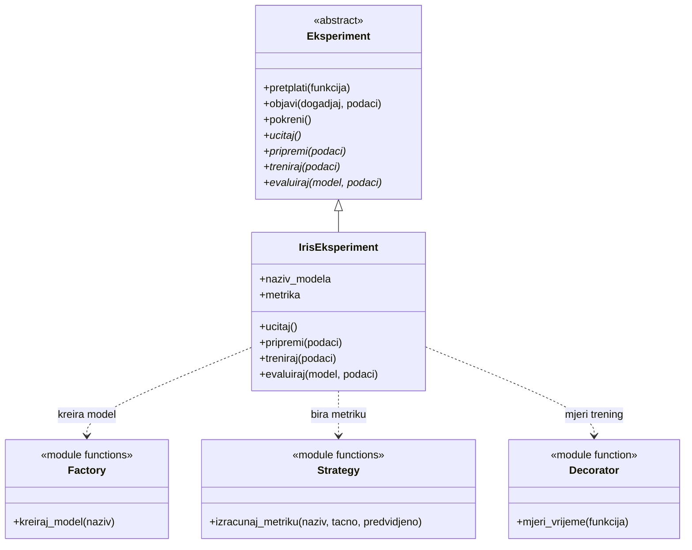

# Mini projekat 2 – ML eksperimenti

Ovaj projekat pokazuje kako se projektni šabloni mogu koristiti za pokretanje jednostavnih eksperimenata mašinskog učenja. Primjer koristi Iris skup podataka i tri modela iz biblioteke scikit-learn.

U projektu su korišćeni sljedeći šabloni:

- Factory bira i kreira model na osnovu naziva: linearni model, stablo odlučivanja ili kNN.
- Strategy omogućava izbor metrike (accuracy ili macro F1) bez promjene toka eksperimenta.
- Observer obavještava pretplatnike o početku i kraju treninga i o završetku evaluacije.
- Template Method određuje redoslijed koraka: učitavanje, priprema, treniranje, evaluacija.
- Decorator mjeri vrijeme treniranja bez promjene povratne vrijednosti metode.

## Pokretanje

Instalacija biblioteka:

```bash
pip install -r requirements.txt
```

Pokretanje demonstracije:

```bash
python ml_okvir.py
```

Pokretanje testova:

```bash
python -m pytest -v
```

Demonstracija koristi isti Iris skup i istu podjelu podataka (80% trening, 20% test) za sva tri modela. Rezultati zavise od verzije biblioteka, pa nijesu unaprijed fiksirani.

## Dijagram klasa (Mermaid)



*Napomena:* Factory, Strategy i Decorator su prikazani kao cjeline u dijagramu radi preglednosti, ali su u Python kodu implementirani funkcijama, a ne klasama. Observer je implementiran listom pretplatnika u klasi `Eksperiment`.


